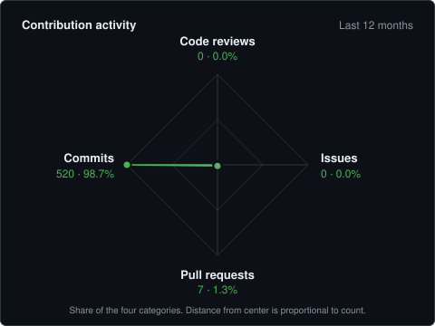

# Ayush Kulshreshtha

**Java backend developer · B.Tech Computer Science at SRMIST**

I build backend systems with Java and Spring Boot: multi-tenant SaaS, event-driven pipelines with
Kafka, and retrieval-augmented services around LLMs. I care about the parts that make them hold up:
tests against real infrastructure, measured quality, cost control and observability. I also
contribute fixes to open-source Java projects such as Apache SkyWalking and Keycloak.

`CGPA 9.2 / 10` · `1st Place, NitroStack Hackathon` · `5 upstream PRs, 3 merged` · `170+ LeetCode`

---

## Featured projects

### [RepoMind](https://github.com/Ayush0612005/repomind): codebase intelligence for Java repositories

**[Try the demo](https://ayush0612005.github.io/repomind/)** · [Source](https://github.com/Ayush0612005/repomind)

Ask a GitHub Java repository questions and get answers that cite the exact lines. RepoMind also
reviews pull requests from GitHub webhooks and serves AI coding agents as an **MCP server**.

- **Indexing:** Kafka ingestion with idempotent workers; JavaParser splits code into class outlines and per-method chunks
- **Hybrid retrieval:** pgvector similarity + Postgres full-text search, fused with reciprocal rank fusion
- **Cost and resilience:** two-tier answer cache (Redis + pgvector semantic), per-client rate limits and token budgets in Redis, Claude → Ollama failover behind circuit breakers
- **Measured:** a 40-question labelled eval gates CI; hybrid search finds the right code in the top 5 for **90%** of questions (keyword-only: 75%)
- **Operated:** Prometheus metrics, a 30-panel Grafana dashboard, a production Compose stack behind Caddy

`Java 25` `Spring Boot 4` `Spring AI` `PostgreSQL + pgvector` `Kafka` `Redis` `Resilience4j` `Testcontainers`

### [ClubHub](https://github.com/Ayush0612005/clubhub-api): multi-tenant SaaS for college clubs

**[Try the live demo](https://clubhub-mocha.vercel.app)** (one click, no sign-up) · [Source](https://github.com/Ayush0612005/clubhub-api)

Recruitment pipelines, events with signed QR tickets, verifiable PDF certificates and live
notifications for college clubs, plus a public directory of the 75 clubs at SRM KTR.

- **Tenant isolation in the database:** a PostgreSQL schema per club, selected from a signed JWT claim, with membership re-checked on every request
- **Auth:** 15-minute JWTs and rotating refresh tokens; replaying an old one revokes the whole login
- **Correct under concurrency:** row locks keep event capacity exact; a unique constraint stops double check-ins
- **Event-driven:** domain events published to Kafka after commit, idempotent consumers, a dead-letter topic, WebSocket push
- **Tested for real:** 204 tests on PostgreSQL 18, Kafka and Redis via Testcontainers, on every push

`Java 25` `Spring Boot 4` `PostgreSQL` `Kafka` `Redis` `WebSocket` `React 19` `TypeScript`

### Earlier projects

| Project | What it is | Stack |
|---|---|---|
| [E-Commerce Full Stack](https://github.com/Ayush0612005/ecommerce-fullstack) · [live](https://ecommerce-frontend-3oyq.onrender.com) | Store with JWT auth, cart, checkout, payments, orders and an admin dashboard | Spring Boot, React, TypeScript, TiDB Cloud, Docker |
| [Expense Tracker](https://github.com/Ayush0612005/expense_tracker) | REST API with Redis caching and Kafka event-driven auditing | Spring Boot, MySQL, Redis, Kafka, JWT |
| [URL Shortener](https://github.com/Ayush0612005/url-shortener-springboot) | Short links with Redis cache-aside redirects and click analytics | Spring Boot, MySQL, Redis, JWT, JUnit |
| [Library Management System](https://github.com/Ayush0612005/library-management-system-springboot) | Books, users and issue/return workflows behind Spring Security | Spring Boot, Spring Data JPA, MySQL, JWT |

---

## Open source

| Project | Contribution | Status |
|---|---|---|
| [Apache SkyWalking Java agent](https://github.com/apache/skywalking-java) | [#832](https://github.com/apache/skywalking-java/pull/832): fixed [apache/skywalking#14097](https://github.com/apache/skywalking/issues/14097), where the HttpClient 5.x plugin could stop the caller's active span. Reworked the async exit-span lifecycle, enabled tracing for HttpClient 5.4+ and extended tests to 5.0–5.6. Ships in agent 9.8.0. | ✅ Merged |
| [Keycloak](https://github.com/keycloak/keycloak) | [#53517](https://github.com/keycloak/keycloak/pull/53517): fixed [#53456](https://github.com/keycloak/keycloak/issues/53456), where time-based policies saved from the Admin Console made every permission using them fail with HTTP 500. Blank repeat fields now count as unset, with regression tests. | ✅ Merged |
| [OpenTelemetry Java Instrumentation](https://github.com/open-telemetry/opentelemetry-java-instrumentation) | [#20442](https://github.com/open-telemetry/opentelemetry-java-instrumentation/pull/20442): removes a redundant span-context conversion in the API bridge ([#20340](https://github.com/open-telemetry/opentelemetry-java-instrumentation/issues/20340)) by unwrapping bridged spans and lazily caching the immutable `SpanContext`. | 🔄 In review |
| [Apache Pulsar Connectors](https://github.com/apache/pulsar-connectors) | [#145](https://github.com/apache/pulsar-connectors/pull/145): regression tests proving the Redis sink keeps its socket options in cluster mode ([#131](https://github.com/apache/pulsar-connectors/issues/131)). | 🔄 In review |
| [Spring Lens](https://github.com/sdlc-pro/spring-lens) | [#312](https://github.com/sdlc-pro/spring-lens/pull/312): added `BeanProxyInfoInspector`, surfacing Spring bean proxy details in the Bean Explorer. | ✅ Merged |

---

## What I work with

**Languages**  
`Java` `Python` `C` `C++` `TypeScript` `SQL`

**Backend**  
`Spring Boot` `Spring Security` `Spring AI` `JPA / Hibernate` `REST APIs` `JWT` `WebSocket (STOMP)` `Flyway` `Resilience4j`

**AI and retrieval**  
`RAG` `pgvector` `Hybrid search` `Embeddings` `Ollama` `Claude API` `MCP`

**Data and messaging**  
`PostgreSQL` `MySQL` `MongoDB` `Redis` `Apache Kafka`

**Testing, DevOps and cloud**  
`JUnit 5` `Mockito` `Testcontainers` `Docker` `GitHub Actions` `Prometheus` `Grafana` `AWS S3 / SES` `Render` `Vercel`

---

## GitHub Activity

Counts come from the GitHub GraphQL API and are refreshed daily by [a workflow](https://github.com/Ayush0612005/Ayush0612005/blob/main/.github/workflows/update-activity.yml).

---

## Achievements

- **1st Place, NitroStack Hackathon**
- Smart India Hackathon 2026 (Smart Automation theme); Samsung PRISM GenAI Hackathon 2026, Agentic Code Intelligence track
- **170+ LeetCode problems** in Java: arrays, strings, linked lists, binary search, sorting, recursion
- Member, AWS Student Builder Group (Cloud & DevOps) at SRM KTR

## Education

**SRM Institute of Science and Technology, Kattankulathur**  
B.Tech, Computer Science and Engineering · 2025–2029 · CGPA 9.2 / 10

## Currently learning

System design · Distributed systems · Evaluating RAG systems · AWS · Advanced DSA

---

## Say hi

[LinkedIn](https://www.linkedin.com/in/ayush-kulshreshtha-0066661b9) · [Email](mailto:ayushkulshreshtha37@gmail.com) · [GitHub](https://github.com/Ayush0612005)
